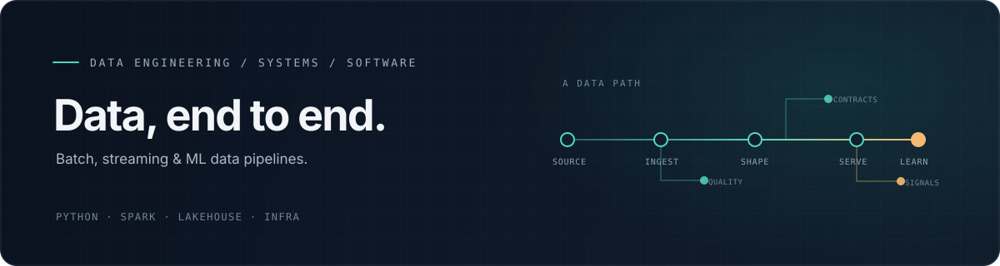

  

<h1 align="center">Vu Ngoc Bao Thang</h1>

  <strong>Data Engineer · Batch, Streaming &amp; ML Data Pipelines</strong> 
  <a href="https://github.com/vngbthang">GitHub · @vngbthang</a>

  <a href="#areas-of-focus">Focus</a> &nbsp;·&nbsp;
  <a href="#tech-stack">Stack</a> &nbsp;·&nbsp;
  <a href="#activity">Activity</a>

---

  I work where <strong>data engineering</strong> meets <strong>backend systems</strong> and <strong>infrastructure</strong> — building dependable paths from raw inputs to useful data.

## Areas of Focus

<table>
  <tr>
    <td width="33%" valign="top">
      <strong>01 &nbsp; DATA SYSTEMS</strong>  
      Batch and streaming pipelines, lakehouse storage, data modeling, and quality checks.
    </td>
    <td width="33%" valign="top">
      <strong>02 &nbsp; BACKEND</strong>  
      APIs and integrations, databases, clear data contracts, and reliable workflows.
    </td>
    <td width="33%" valign="top">
      <strong>03 &nbsp; PLATFORM</strong>  
      Cloud foundations, containers, orchestration, CI/CD, and observability.
    </td>
  </tr>
</table>

### One system, end to end

  <strong>COLLECT</strong> &nbsp; → &nbsp; <strong>INGEST</strong> &nbsp; → &nbsp; <strong>TRANSFORM</strong> &nbsp; → &nbsp; <strong>STORE</strong> &nbsp; → &nbsp; <strong>SERVE</strong> &nbsp; → &nbsp; <strong>OBSERVE</strong>

Files · APIs · events &nbsp; / &nbsp; Spark · Kafka · dbt &nbsp; / &nbsp; Lakehouse · SQL · analytics

## Tech Stack

  
  
  
  
  
  
  
  
  
  
  
  

Also worked with PySpark, Iceberg, MinIO, DuckDB, SQL Server, SSIS, SSAS, Streamlit, Git, and scikit-learn.

## Activity

  
  &nbsp;
  

Public GitHub data · language share reflects code volume, not proficiency

  Information Technology · University of Information Technology, VNU-HCM · 2023–2026 
  Curious about data. Interested in the systems that make it useful.

